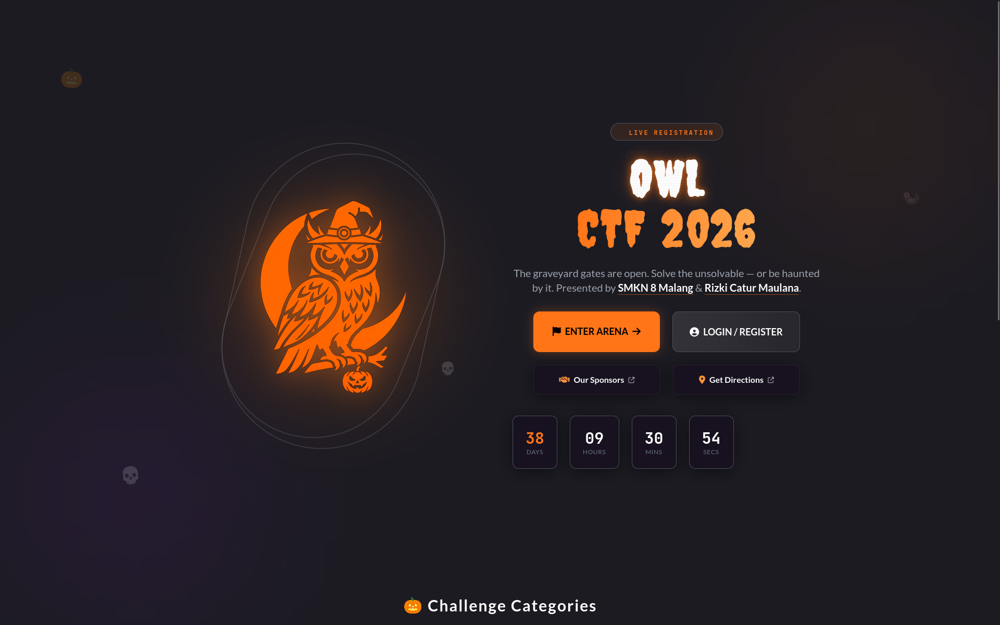
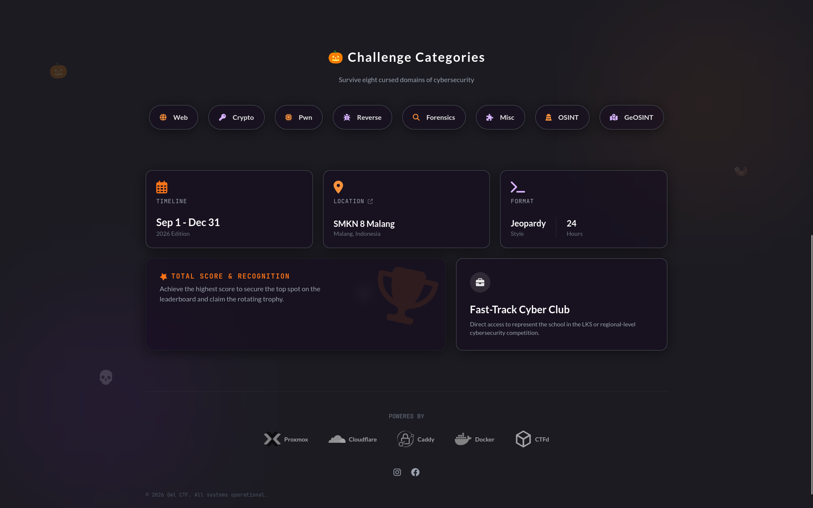
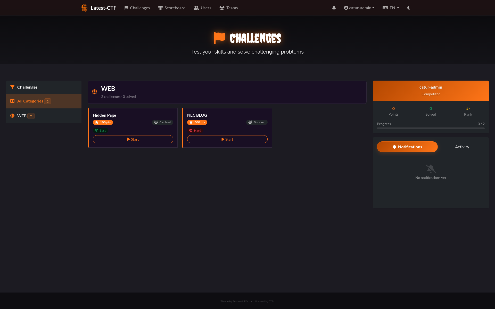
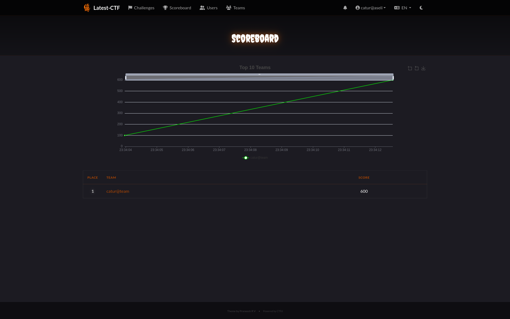
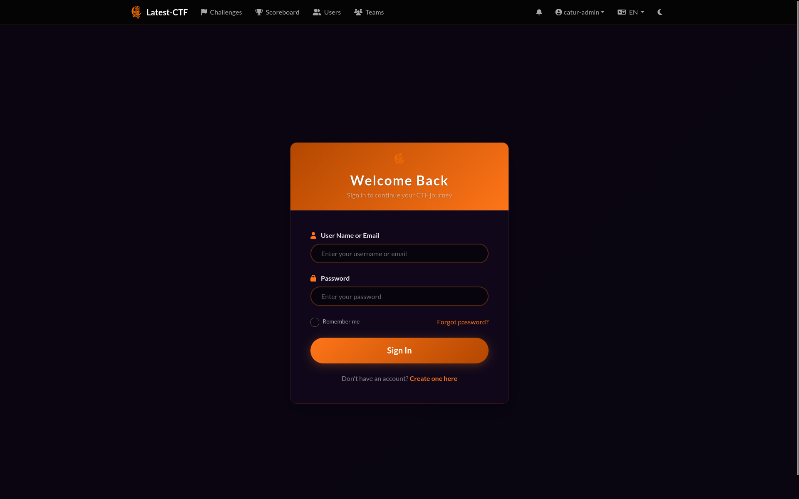
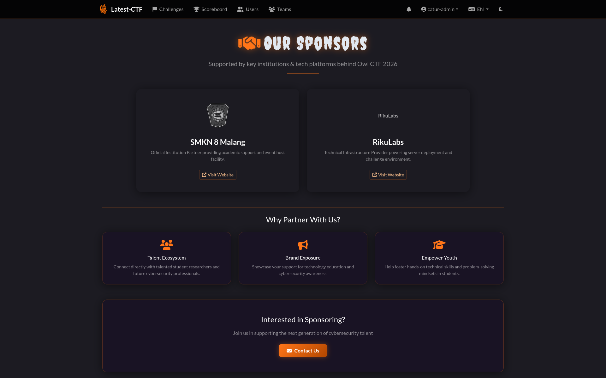
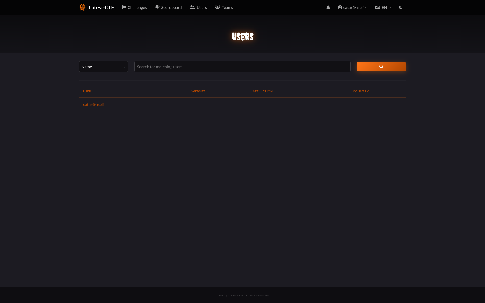
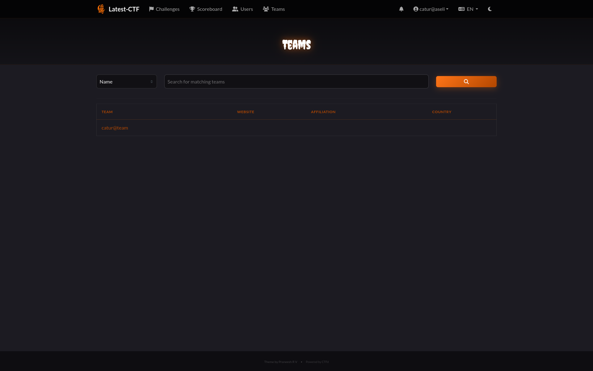

# 🎃 OWL CTF Halloween Theme 🦉

<div align="center">



A modern, haunted Halloween & cyber-gothic dark theme for [CTFd](https://ctfd.io/). Crafted with glowing pumpkin-orange accents (`#ff7518`), deep midnight-violet hues (`#0b0614`), frosted glassmorphism cards, spooky Creepster typography, cyberpunk glitch effects, and a dedicated sponsors showcase.

**Designed for OWL CTF 2026 by [Rizki Catur Maulana (RikuLabs)](https://github.com/Rizzkiy) & [SMKN 8 Malang](https://smkn8malang.sch.id/).**

[](https://ctfd.io/)
[](theme.json)
[](LICENSE)
[](https://tailwindcss.com/)

</div>

---

## 📸 Showcase & Preview

A complete visual walkthrough of the Owl CTF Halloween experience:

| | |
|:-------------------------:|:-------------------------:|
| **Homepage Hero & Live Countdown** <br> [](images/home-hero.png) <br> *Cyberpunk glitch headline, glowing mascot, quick action CTA buttons, and real-time countdown timer.* | **Timeline & Categories** <br> [](images/home-schedule.png) <br> *Curated competition roadmap, event schedule, and cyber challenge category tags.* |
| **Challenges Arena** <br> [](images/challenges.png) <br> *Interactive Alpine.js challenge matrix with category filtering, solve indicators, and custom modal windows.* | **Dynamic Scoreboard** <br> [](images/scoreboard.png) <br> *Live real-time ECharts score progression graph and ranking leaderboard styled with neon orange glow.* |
| **Authentication (Login & Register)** <br> [](images/login.png) <br> *Gothic obsidian glassmorphism login & register card with glowing input fields and custom badges.* | **Official Sponsors Showcase** <br> [](images/sponsors.png) <br> *Dedicated partner portal (`/sponsors`) highlighting institutions (SMKN 8 Malang) and tech partners (RikuLabs).* |
| **Users Ranking** <br> [](images/users.png) <br> *Individual player leaderboard featuring country flags, affiliation tags, score progression, and solve breakdown.* | **Teams Leaderboard** <br> [](images/teams.png) <br> *Team standings table with squad profiles, statistics, and solved challenges ranking.* |

---

## ✨ Features

- 🎃 **Haunted Halloween Atmosphere**: Midnight graveyard violet palette (`#0b0614`) combined with vibrant neon pumpkin-orange highlights (`#ff7518`).
- ⚡ **Cyberpunk Glitch Text Effect**: Multi-layered glitch typography with scanline animations and noise texture for the hero headline.
- 🪦 **Spooky Typography**: Integrated Google Fonts **[Creepster](https://fonts.google.com/specimen/Creepster)** for headings and banners, harmonized with **[Inter](https://fonts.google.com/specimen/Inter)** and **[JetBrains Mono](https://www.jetbrains.com/lp/mono/)** for clean, readable challenge prompts and code snippets.
- 🪟 **Refined Glassmorphism UI**: High-end frosted glass containers (`backdrop-filter: blur(12px)`), translucent tables, and subtle glowing hover borders.
- ⏳ **Interactive Live Countdown**: Real-time ticker counting down days, hours, minutes, and seconds to the CTF launch.
- 🎯 **Thematic SVG Cursor**: Custom precision crosshair and pointer cursors with neon orange tracking reticles.
- 👻 **Floating Ambient Decor**: Subtle floating jack-o'-lanterns 🎃, bats 🦇, and skulls 💀 drifting across the background.
- 🧩 **Enhanced Challenge Board**: Three-column challenge layout with category filters (Web, Crypto, Pwn, Reverse, Forensics, Misc, Mobile, OSINT, Blockchain), instant search, and solved indicators.
- 🤝 **Dedicated Sponsors Portal**: Built-in `/sponsors` page to celebrate event partners, featuring logo grayscale-to-color hover transitions and tier badges.
- 📱 **Fully Responsive**: Flawless layout on desktop, tablet, and mobile devices with collapsible navigation.

---

## 📦 Installation Guide

### Option 1: Git Clone (Recommended)

1. Open a terminal and navigate to your CTFd installation's `themes/` directory:
   ```bash
   cd /path/to/CTFd/CTFd/themes/
   ```

2. Clone this repository directly into a folder named `owl-ctf-halloween`:
   ```bash
   git clone https://github.com/Rizzkiy/owl-ctf-halloween.git owl-ctf-halloween
   ```

3. Restart your CTFd instance (if running in Docker):
   ```bash
   docker compose restart
   ```

### Option 2: Manual Copy

1. Download or extract this repository into your CTFd themes directory:
   ```bash
   cp -r /path/to/owl-ctf-halloween /path/to/CTFd/CTFd/themes/
   ```

### ⚙️ Activating the Theme in CTFd Admin Panel

1. Log into your CTFd instance with an **Administrator** account.
2. Go to the **Admin Panel** (`/admin`).
3. Navigate to **Config** > **Appearance** (or **Themes** tab depending on CTFd version).
4. Under **Theme**, select **Owl CTF Halloween** from the dropdown menu.
5. Click **Update** to save changes.
6. Visit your CTFd homepage — the Halloween experience is now live!

---

## 🛠️ Project Structure & Customization

```text
owl-ctf-halloween/
├── assets/                  # Source SCSS, JS, fonts, and brand assets
│   ├── img/                 # Mascot, CTFd logos, and custom graphics
│   └── scss/                # Core stylesheet variables and components
├── images/                  # Theme showcase screenshots for README
├── static/                  # Compiled assets ready for distribution
├── templates/               # CTFd Jinja2 HTML templates
│   ├── base.html            # Main skeleton, CSS variables & Creepster font
│   ├── index.html           # Halloween landing page with glitch hero & countdown
│   ├── challenges.html      # Challenge grid with Alpine.js category filters
│   ├── challenge.html       # Challenge detail modal dialog
│   ├── scoreboard.html      # Real-time leaderboard and solve graph
│   ├── sponsors.html        # Official sponsors showcase page
│   ├── login.html           # Spooky dark authentication login card
│   ├── register.html        # Registration portal
│   └── components/          # Reusable components (navbar, footer, etc.)
├── theme.json               # CTFd theme metadata & descriptor
├── package.json             # Build toolchain & dependencies
└── vite.config.js           # Vite build bundler configuration
```

### 🎨 Customizing Theme Colors

You can easily adjust the theme's core color palette in `templates/base.html` or `templates/index.html`:

```css
:root {
  --red: #ff7518;        /* Main Pumpkin Orange Accent */
  --red-light: #ffa64d;  /* Bright Glow / Hover Accent */
  --red-dim: #b34700;    /* Dark Orange */
  --red-dark: #4a1a5c;   /* Deep Halloween Violet */
  --red-glow: rgba(255, 117, 24, 0.5); /* Ambient Orange Glow */
  --glass-bg: rgba(15, 10, 18, 0.6);   /* Obsidian Glass Background */
}
```

### 🦉 Customizing Mascot & Branding

- **Hero Logo**: The homepage hero mascot is configured in `templates/index.html` (around line 432). You can point it to your custom logo URL or place an image in `assets/img/` and compile it.
- **CTFd Logo**: You can upload your CTF event logo through **Admin Panel** > **Config** > **Appearance** > **Logo**.
- **Sponsors Page**: Add or modify sponsors and logos inside `templates/sponsors.html`.

---

## 💻 Development & Building Assets

If you wish to modify the SCSS stylesheets or JavaScript bundles and rebuild static assets:

1. Install dependencies:
   ```bash
   yarn install
   # or
   npm install
   ```

2. Run in development watch mode:
   ```bash
   yarn dev
   # or
   npm run dev
   ```

3. Build production-ready assets:
   ```bash
   yarn build
   # or
   npm run build
   ```

---

## 🤝 Credits & Acknowledgements

This theme was built with passion for cybersecurity education and competitive CTF events:

- **[CTFd Platform](https://ctfd.io/)**: Built for and powered by the open-source Capture The Flag platform created by [Kevin Chung](https://github.com/ColdHeat) and the [CTFd Community](https://github.com/CTFd/CTFd).
- **Theme Inspiration & Foundation**: Heavily inspired by and adapted from the wonderful **[Stargaze Theme](https://github.com/PraneeshRV/CTFd-stargaze-theme)** created by **[Praneesh R V](https://github.com/PraneeshRV)**. We transformed the glassmorphism space concept into a spooky Halloween cyber-graveyard experience.
- **Created for**: **OWL CTF 2026**
- **Author & Maintainer**: **[Rizki Catur Maulana (RikuLabs / @Rizzkiy)](https://github.com/Rizzkiy)**
- **Institutional Partner**: **[SMKN 8 Malang](https://smkn8malang.sch.id/)**

---

## 📄 License

This project is licensed under the **MIT License** — see the [LICENSE](LICENSE) file for details.

> **Attribution Note**: Pursuant to the MIT license terms of the original Stargaze theme, visible attribution to the original author ([Praneesh R V](https://github.com/PraneeshRV)) and the original repository is preserved in this repository and documentation.
